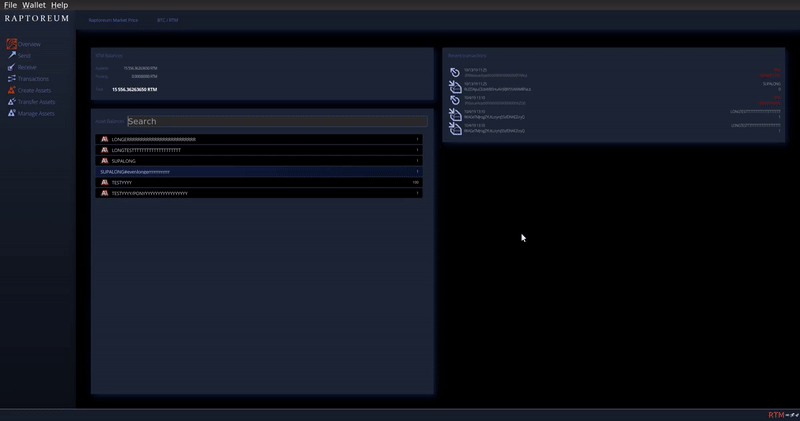

# Solo Mining

:::note

Yerbas network difficulty makes it hard to solo mine a block with the wallet. If you want dependable and regular payouts it is recommended to use pool mining.

:::

- Download the core wallet: https://github.com/the-yerbas-endeavor/yerbas/releases

- Open and sync

- Once done go to Help > Debug Window > Console and type 

```bash
setgenerate true 2
```
The number sets the mining processor/thread limit (`genproclimit`), not a physical-core affinity setting. Use `setgenerate false` to stop mining. It will start mining and you will know when you hit a block as your balance will change.




